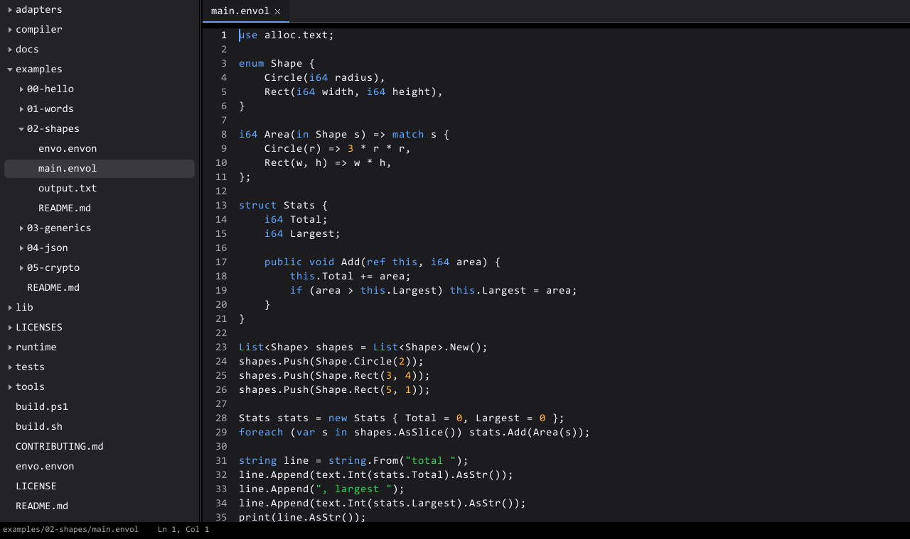
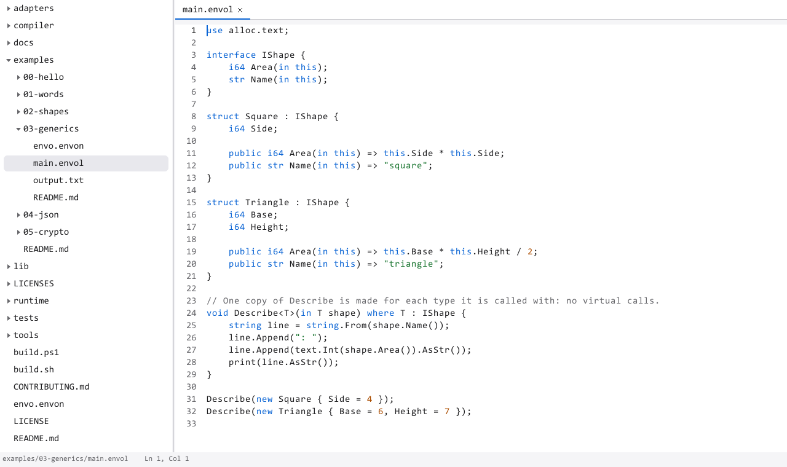

# Envide

A code editor and IDE written in [Envol](https://github.com/envoscale/EnvoScale), drawn
with [Envoui](https://github.com/envoscale/Envoui) and [Envor](https://github.com/envoscale/Envor):
no third-party code, and the same pixels on Windows and Linux.

<p align="center">
  
</p>

<p align="center">
  
</p>

Both pictures are Envide drawing itself, without a window:

```bash
envide path/to/EnvoScale examples/02-shapes/main.envol --screenshot dark.ppm --size 1280x760
envide path/to/EnvoScale examples/03-generics/main.envol --screenshot light.ppm --light --size 1280x760
```

## What it does

- A sidebar with the folder's files: folders first, names in order, build output left
  out. Folders open and close; choosing a file opens it.
- The editor: syntax colors, line numbers, multiple cursors, selections and undo.
- A status bar with the file and the cursor's position, and a command palette
  (Ctrl+Shift+P).

Next: saving, then diagnostics, completion and go-to-definition through `envo lsp`, then
build, run, test and debug.

## Use

```bash
./build.sh run                         # build, then open Envide on this folder
build/envide <folder> [file]           # open a folder, and a file in it
```

`./build.sh` clones EnvoScale at the commit in [`envoscale.ref`](envoscale.ref) and builds
it (about a minute, once); set `ENVOSCALE` to use a checkout of your own. `./build.sh
test` runs the tests.

## Code

| File | |
|---|---|
| [`shell.envol`](shell.envol) | The window's parts and what input does to them. It never touches the window, so the tests drive it directly. |
| [`main.envol`](main.envol) | Arguments, then the window and its loop, or one frame into an image |
| [`tests/`](tests) | Tests, run by `envo test` |

Anything Envide needs from the operating system is a port in EnvoScale's library with
adapters there, never code here.

## License

Same as EnvoScale: see [LICENSE](LICENSE).
