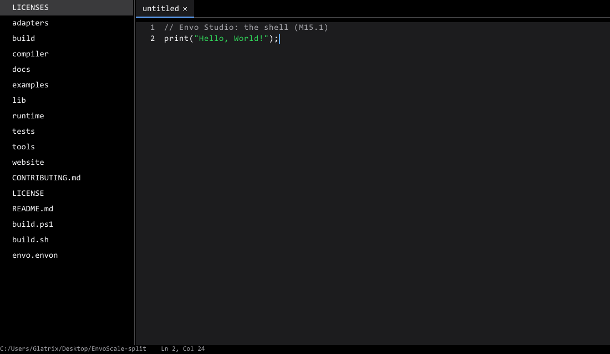

# Envide

A code editor and IDE written in [Envol](https://github.com/envoscale/EnvoScale), on Envol's
own standard library: no third-party code, and the same program on Windows, Linux and
(later) in the browser.



**Where it is:** the shell. A sidebar with the folder's files, tabs, the code editor with
syntax colors, a status bar with the cursor's position, and a command palette
(Ctrl+Shift+P). Next: opening and saving files, then diagnostics, completion and
go-to-definition through `envo lsp`, then build, run, test and debug.

## Build

```bash
./build.sh run
```

This clones EnvoScale at the commit in [`envoscale.ref`](envoscale.ref), builds it (about
a minute, once), then builds and opens Envide. `./build.sh test` runs the tests. To use an
EnvoScale checkout you are working on, set `ENVOSCALE` to its folder.

## Code

| File | |
|---|---|
| [`shell.envol`](shell.envol) | The window's parts and what input does to them. It never touches the window, so the tests drive it directly. |
| [`main.envol`](main.envol) | Opens the window and runs the loop |
| [`tests/`](tests) | Tests, run by `envo test` |

Anything Envide needs from the operating system is a port in EnvoScale's library with
adapters there, never code here.

## License

Same as EnvoScale: see [LICENSE](LICENSE).
